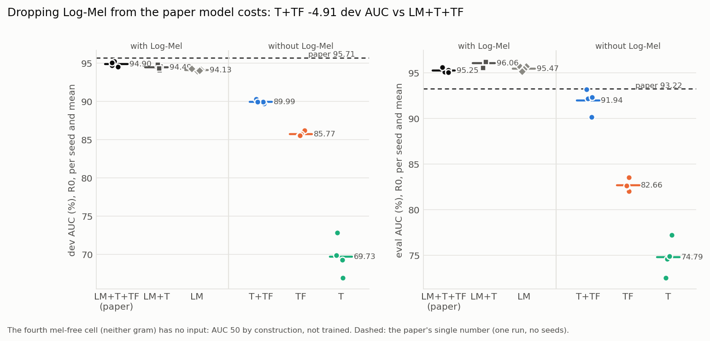
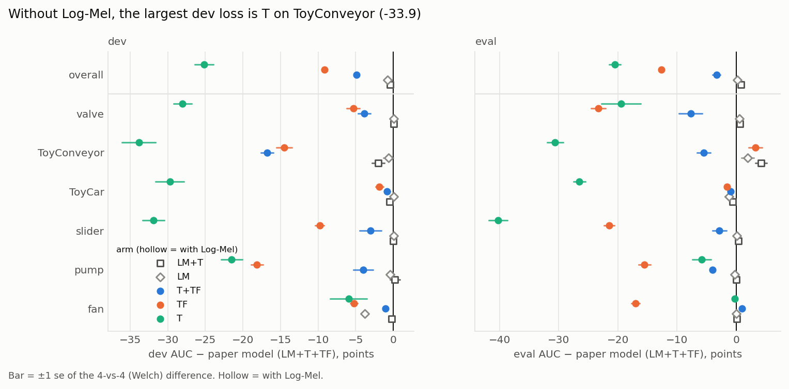
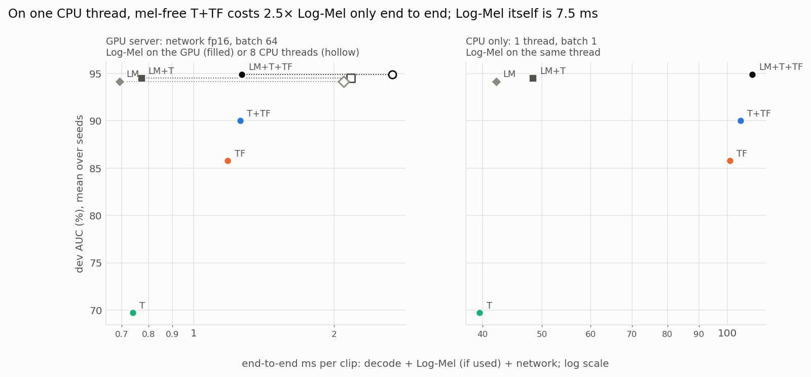
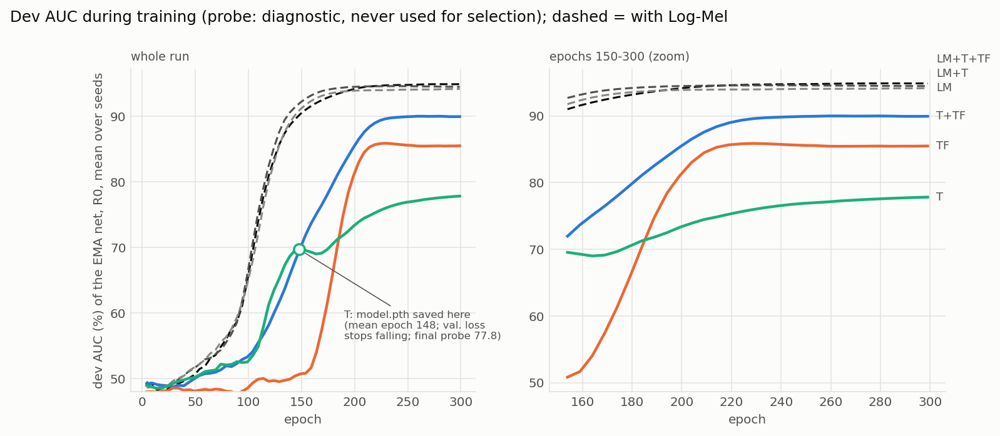

# No Log-Mel: can the raw-waveform branches replace the spectrogram?

> **[Annotation, 2026-10-23, from `../margin-warmup` (n=4).]** A student-margin
> warm-up removes the ArcFace margin trap in f6 and f7 (12/12 runs PASS). It
> lifts TF-only to 87.25 dev / 86.68 eval and T-only to 79.75 / 81.41.
>
> - **Shrunk:** C2b (TF − LM) becomes **−6.77 / −9.08**, and C4 (T − TF)
>   becomes **−7.50 / −5.27**. Most of T-only's old deficit was checkpoint
>   selection at epoch ~150.
> - **Unchanged:** C1, C2a, D1, D2 and D3 rest on never-trapped cells. TFgram
>   alone still does not replace Log-Mel. The original numbers below are kept.

> **Status: done 2026-10-21. All 16 runs scored; D1 and D2 fail by wide
> margins.** Dropping Log-Mel from the paper model costs **−4.9 dev / −3.3
> eval AUC**: Tgram+TFgram reaches 90.0 / 91.9 against 94.9 / 95.3. TFgram
> alone is 8.4 dev and 12.8 eval points below Log-Mel alone. The speed premise
> also fails, because TFgram, not Log-Mel, is the expensive branch (Cost,
> below). The single-branch runs are partly an optimisation failure, the
> ArcFace margin trap (Interim, below). That is followed up in
> `../margin-warmup` (branch `ablation/margin-warmup`).
>
> The accuracy predictions were written blind; P1, P2 and P5 fail.
> Cost predictions P6–P7 were written after a smoke test of `bench.py` had
> shown the per-clip Log-Mel and network times, so they are not blind; they
> are kept as statements to check against the full bench.

## Why this exists

OS-SCL's input is three 128 × 313 channels: Log-Mel, Tgram and TFgram. Log-Mel
is the only fixed DSP front-end. `dataloader.py` computes it on the CPU per
item (`Wave2Mel`, torchaudio), and the two grams are learned 1-D conv stacks on
the raw waveform that run on the GPU. Two motivations for dropping Log-Mel:

1. **Cost.** Log-Mel is computed on the CPU. A mel-free model is one conv graph
   from waveform to score, with no STFT op. That suits accelerators that only
   run convolutions.
2. **Redundancy.** `../gram-branch-redundancy` found TFgram is largely a
   re-derivation of Log-Mel: frame-level CKA 0.81, R² 0.63 (TFgram from
   Log-Mel). `../seed-sweep` and `../tfgram-linear` then found that removing,
   freezing or linearising TFgram stays within seed noise at n=4. All of that
   asks whether TFgram is needed *given* Log-Mel. This ablation asks the
   reverse: is Log-Mel needed given TFgram? Redundancy in a linear probe does
   not imply that one branch can stand in for the other in detection.

The 2 × 2 the question asks for is Tgram in/out × TFgram in/out, with no
Log-Mel. The cell with neither branch has no input at all: AUC 50 by
construction, so it is drawn as a floor and not trained. With the Log-Mel
side, it is a 2 × 2 × 2 design:

| Log-Mel | Tgram | TFgram | fussion | run | status |
|---|---|---|---|---|---|
| ✓ | ✓ | ✓ | 1 | `fr_f1` (paper model) | `../fast-recipe`, n=4, trained |
| ✓ | ✓ | – | 4 | `fr_f4` (STgram) | `../fast-recipe`, n=4, trained |
| ✓ | – | – | 2 | **`nl_f2`** | new here: reference for the TFgram-vs-Log-Mel swap |
| ✓ | – | ✓ | 3 | `f3_mel_tfgram` | old recipe, n=1 only; not rerun (not needed by any contrast) |
| – | ✓ | ✓ | **5** | **`nl_f5`** | new |
| – | – | ✓ | **6** | **`nl_f6`** | new |
| – | ✓ | – | **7** | **`nl_f7`** | new |
| – | – | – | – | (no input) | AUC 50, not trained |

### What the speed argument does and does not cover

`../fast-recipe`'s bench already shows that **TFgram, not Log-Mel, dominates
GPU time**: a training step runs at 5.07 it/s with all three branches, 10.75
it/s with Log-Mel + Tgram and 11.95 it/s with Log-Mel alone. With the data
cache, Log-Mel costs training nothing. So the speed case is about
**inference**, where every clip must be decoded and transformed. There, the
right baseline for "Log-Mel is slow on the CPU" is "compute Log-Mel on the
GPU". `torchaudio`'s transform runs there unchanged and agrees with the CPU
mel to ~4e-5 dB (`bench.py` checks this). `bench.py` therefore measures every
piece separately: wav decode, Log-Mel on CPU at 1 and 8 threads and on GPU,
and the network per mode on GPU (batch 64 fp32/fp16, batch 1) and CPU (batch 1,
1 and 8 threads). Then the README can say which deployment each
configuration wins on.

## Literature (survey 2026-10-19, read after the predictions were written)

- **TFgram is PANNs' Wavegram.** OS-SCL says "TFgramNet is a modification of
  PANN [19] with global max pooling". Its first layers match the Wavegram
  front-end of Kong et al. (TASLP 2020, arXiv 1912.10211): Conv1D k=11 s=5,
  then blocks of two convs with dilation 1 and 2. OS-SCL swaps PANNs' stride-4
  pooling for adaptive max-pool to 626 and then 313 frames. The dead
  `conv_block1-6`/`fc_audioset` modules in `model/waveq.py` are PANNs' CNN14,
  left over from its Wavegram-Logmel-CNN. In PANNs (Table XI, AudioSet mAP),
  **Wavegram-CNN alone scores 0.389, against 0.431 for log-mel CNN14** at the
  same backbone. Combining both gives 0.439. The waveform-only branch was
  worse, and helped only in combination with log-mel.
- **Tgram alone was far below log-mel in its own paper.** STgram-MFN (arXiv
  2201.05510, Table 4, CE loss, no ArcFace, DCASE 2020 dev): LogMel-MFN
  87.67 AUC / 69.91 mAUC, **Tgram-MFN 75.18 / 60.80**, STgram-MFN 89.68 /
  76.04. Per machine, Tgram alone *beat* log-mel on fan (89.5) and pump (89.1).
  It collapsed on slider (71.6, mAUC 27.5), ToyCar (60.7) and ToyConveyor
  (52.7).
- **OS-SCL itself** reports no table without Log-Mel. For reference: Log-Mel
  only 94.64 / 88.42 / 89.24 (dev AUC / pAUC / mAUC), TFSTgram 95.71 / 90.23
  / 91.23 (Tables II, IV). The two rows were trained with different heads and
  margins.
- **No DCASE system was found** (2020–2024 reports, the task-2 summary arXiv
  2006.05822) that trains a waveform-only learnable front-end and matches
  log-mel. Other non-mel ASD front-ends are fixed transforms (gammatone,
  non-uniform filterbanks, complex spectra).
- **General audio.** LEAF (arXiv 2101.08596) beats mel on average (76.9 vs
  73.9), but mel + PCEN reaches 76.4: most of the gain is the compression,
  not the learned filters. EfficientLEAF (arXiv 2207.05508): learnable
  front-ends "fail to consistently outperform a fixed mel filterbank".
  Learned filters stay near their mel init (LEAF; Anderson et al., arXiv
  2302.10014).
- **Cost.** nnAudio (arXiv 1912.12055): mel on GPU is ~1000× faster than
  librosa on CPU. EfficientLEAF Table I: STFT-mel runs at 85k examples/s,
  LEAF at 250.

So the literature agrees with the direction of P1–P3. It is more pessimistic
about Tgram alone (−12.5 AUC under CE), and it says fan and pump are where
Tgram is *strongest*, which cuts against P5. None of these sources
used ArcFace + mixup + SupCon. The predictions are left as written.

## Implementation (branch `ablation/no-logmel`, from `ablation/lit-arms`)

- `model/net.py`: `FUSSION_BRANCHES` gains modes 5 = (Tgram, TFgram),
  6 = (TFgram) and 7 = (Tgram). Modes 1–4 are unchanged: same state_dict keys
  and parameter counts, lean and non-lean (checked). Lean parameter counts:
  f5 1.3770 M, f6 1.0960 M, f7 1.1777 M. Each is its Log-Mel sibling minus
  conv1's input channel (576 parameters). `--mel_gate` now refuses a mode
  with no Log-Mel branch.
- Nothing else changes. The data loader still reads the cached mel and
  mixup still mixes it; a mel-free model ignores that tensor. Mixup draws are
  identical across arms at a given seed.
- **Mixup differs in meaning across the two sides.** Mixup interpolates the
  waveform linearly and the Log-Mel *in dB*. A mel-free model only ever sees
  the true mixture of two clips. A Log-Mel model sees a dB interpolation, which
  is not the mel of the mixture. This is part of what "removing Log-Mel"
  changes, and it is not separated out here.

## Design

- **Recipe:** the fast recipe exactly as `../fast-recipe` ran `fr_f1`/`fr_f4`:
  `--m 0.4 --ht basic --num_workers 8 --amp fp16 --cudnn_bench 1 --lean 1
  --cache_dir data/cache --probe_every 5`, 300 epochs. Only `--fussion`
  changes. Runs go through `../train_one.sh` (GPU locks, crash-resume).
- **Seeds:** 2040–2043, the same seeds as `fr_f1`/`fr_f4`. This host is not
  bit-reproducible, and different branch sets draw different inits, so the
  seed fixes only the train/valid split and the data stream. Comparisons are
  of **4-seed means**.
- **Runs:** `nl_f5`, `nl_f6`, `nl_f7`, `nl_f2` × 4 seeds = 16 runs, queued
  seed-major on 3 GPUs. At the fast-recipe wall times (f1 ≈ 11–13 h,
  f4 ≈ 6–8 h) that is ≈ 140 GPU-hours, or ≈ 2 days.
- **Gate (before the queue):** a 2-epoch smoke run of each new mode trains
  without non-finite losses under fp16, probes, and reloads strictly in
  `eval.py` (`scores/gate.txt`).
- **Score:** eval.py's R0 on dev and eval, written straight to `scores/`.
  S1′ is not computed here; no decision depends on it.

Noise reference: relu8 dev AUC sd 0.19 (n=8, `../fast-recipe`). A 4-vs-4
difference of means then has a standard error of ≈ 0.13 on dev. Eval is
noisier (relu8 range 95.02–95.86) and ToyConveyor much noisier (CLAUDE.md).

## Contrasts

Δ = 4-seed mean difference, R0 overall AUC, in points.

| contrast | runs | question |
|---|---|---|
| C1 | `nl_f5` − `fr_f1` | cost of dropping Log-Mel from the paper's model |
| C2a | `nl_f5` − `fr_f4` | TFgram in place of Log-Mel, next to Tgram |
| C2b | `nl_f6` − `nl_f2` | TFgram in place of Log-Mel, alone |
| C3 | `nl_f5` − `nl_f6` | what Tgram adds once Log-Mel is gone |
| C4 | `nl_f7` − `nl_f6` | Tgram vs TFgram as the only branch |

## Predictions (written before any run)

- **P1 (C1).** Dropping Log-Mel costs accuracy. Dev Δ in [−1.2, +0.2],
  central −0.4. Eval Δ in [−1.5, +0.3], central −0.5. So D1 fails, narrowly.
  Reason: R² 0.63 leaves a third of Log-Mel's frame variance unexplained by
  TFgram, and TFgram has no fixed log compression. Its ReLU/BN/max-pool stack
  has to learn the dynamic range that `AmplitudeToDB` hands the
  backbone for free.
- **P2 (C2b).** TFgram alone is below Log-Mel alone: dev Δ in [−2.5, +0.2],
  central −1.0. The single-branch swap hurts more than C2a, because in
  `nl_f5` Tgram carries part of what was lost.
- **P3 (C4).** Tgram is the weakest single branch. `nl_f7` is below both
  `nl_f6` and `nl_f2` on the dev mean, by ≥ 0.5 each. Its first layer is a
  linear strided conv with no magnitude or log step. LayerNorm over time and
  LeakyReLU are its only nonlinearities before the backbone.
- **P4 (C3).** Without Log-Mel, Tgram is no longer redundant: `nl_f5` −
  `nl_f6` dev Δ ≥ +0.3, central +0.5. Tgram is decorrelated from both other
  branches (frame CKA 0.003), and with Log-Mel present it still added
  little (`fr_f4` vs `fr_f1`).
- **P5 (where it is lost).** Of C1's dev loss, ≥ 60% comes from the four
  MIMII types (fan, pump, slider, valve), not from ToyCar/ToyConveyor. The
  MIMII clips carry real factory noise, where the spectral envelope matters.
- **P6 (cost, GPU; not blind).** Log-Mel computed on the GPU costs < 1% of the
  paper model's GPU forward per clip. Computed on one CPU thread, it costs
  more per clip than that whole forward at batch 64.
- **P7 (cost, CPU; not blind).** On a CPU, the mel-free networks with TFgram
  (`f5`, `f6`) cost > 10× the Log-Mel they replace. Log-Mel only (`f2`)
  is cheaper end to end than any configuration with TFgram.

**Amendment (2026-10-19, before any arm had trained).** Once all 8
fast-recipe baselines were scored, their dev AUC sd came out at **0.34**
(`fr_f1`) and **0.33** (`fr_f4`), not relu8's 0.19. The 4-vs-4 se is then
≈ 0.24, so D1's −0.20 margin is below 1 se. If the true Δ is 0, a point
estimate falls under −0.20 about 20% of the time. The rules are kept as
written. Each verdict is reported with its seed-bootstrap 90% interval
(`scores/summary.csv`). A D1 or D2 fail whose interval also covers 0 is
written up as "not resolved at n=4", not as "Log-Mel is needed".

## Decision rules

- **D1, Log-Mel can be dropped from the paper's model**, if C1's Δ ≥ −0.20 on
  both dev and eval (≈ 1.5 se on dev). This is a point-estimate test, not an
  equivalence proof at n=4; per-seed values and a seed bootstrap are
  reported alongside.
- **D2, TFgram functionally replaces Log-Mel**, if C2a and C2b are both
  ≥ −0.20 on dev and on eval. If D2 fails, the CKA redundancy is
  representational only: TFgram duplicates Log-Mel's content but not its
  usefulness to the detector.
- **D3, deployment recommendation.** For each target (GPU server, CPU only),
  recommend the cheapest configuration of all six trained cells whose dev
  and eval means are both within 0.20 of the best cell's. Cost is
  end-to-end per clip from `scores/bench.csv`: decode, plus Log-Mel on the
  same device if the config uses it, plus the network.
- Per-machine results are reported, not decided on.

## What this does not test

- No retuning for the mel-free arms: same lr, epochs, margin, mixup, SupCon τ.
  A learned front-end might want a longer schedule or its own lr.
- No other learnable front-ends (SincNet, LEAF, a learnable mel filterbank).
- The mixup semantics difference above is not isolated.

## Results

### Cost (`scores/bench.txt`, 2026-10-19; RTX A4000, i7-14700, torch 2.6)

ms per clip. Network = forward in eval mode with random inputs. End to end =
decode (0.38 ms) + Log-Mel on the same device, if the config uses one, +
network.

| config | train it/s (b64, fp16) | GPU net b64 fp16 | CPU net, 1 thread | CPU end to end, 1 thread | CPU net, 8 threads |
|---|---|---|---|---|---|
| f1 LM+T+TF (paper) | 5.16 | 0.886 | 102.1 | 110.0 | 38.4 |
| f4 LM+T | 10.88 | 0.391 | 40.5 | 48.3 | 13.4 |
| f2 LM | 12.16 | 0.313 | 34.3 | 42.1 | 10.2 |
| **f5 T+TF** | 5.13 | 0.879 | 104.7 | 105.1 | 38.7 |
| **f6 TF** | 5.34 | 0.804 | 100.7 | 101.1 | 35.7 |
| **f7 T** | 10.86 | 0.361 | 39.2 | 39.6 | 12.9 |
| Log-Mel alone | – | 0.0013 (GPU, b64) | 7.46 | – | 1.29 |

- **P6 holds.** On the GPU, Log-Mel costs 0.0013 ms/clip, 0.15% of the
  paper model's fp16 forward. It matches the CPU mel to 3.8e-5 dB. On one
  CPU thread it costs 7.46 ms, 5× the paper model's whole GPU forward
  (1.45 ms fp32).
- **P7 holds.** On the CPU, the TFgram networks cost 101–105 ms against 7.46 ms
  for Log-Mel (13–14×). Log-Mel only is 42.1 ms end to end, 2.4× cheaper than
  any configuration with TFgram.
- **So dropping Log-Mel buys almost nothing where TFgram stays.** On the
  GPU, f5 and f1 run at the same speed for training and inference. On the CPU,
  f5 saves 4.5% over f1 (105.1 vs 110.0 ms). TFgram is ~65 ms of a
  single-thread forward and about 60% of a training step. The backbone is
  ~34 ms; Tgram and Log-Mel are ~5–7 ms each.
- **The only mel-free config that is cheaper than Log-Mel only is f7 (Tgram
  only):** 39.6 vs 42.1 ms on the CPU (−6%). On the GPU it is slower (0.361 vs
  0.313 ms). Whether that matters depends on its accuracy, which the
  literature expects to be the worst (STgram-MFN Table 4).

### Gate (2026-10-19, `scores/gate.txt`): passed

Each new mode was trained for 2 epochs at seed 1 on GPU 1. All three trained
with **0 non-finite steps under fp16**, probed, and reloaded strictly in
`eval.py`. Their dev AUC was 0.475–0.505, which is expected: `fr_f1`'s EMA net
also sits at ~0.5 until epoch ~130. (The f5/f6 logs say "skipped steps"
with no count because they were first written to the wrong directory;
counted by hand afterwards, both have 0.)

**One early sign:** the mel-free nets learn more slowly at first. Train loss
in the 2-epoch smoke runs (same cosine schedule):

| run | epoch 0 | epoch 1 |
|---|---|---|
| `fr_f1` smoke | 13.28 | not printed (valid loss did not improve) |
| `fr_f4` smoke | – | 10.63 |
| `nl_f5` | 14.92 | 14.03 |
| `nl_f6` | 14.74 | 14.04 |
| `nl_f7` | 15.84 | 15.17 |

The loss falls in all three, so this is not a failure to train.

**[Interim, 2026-10-19 22:30]** The last sentence above was too strong. Two of
the three seed-2040 runs fall into a degenerate state that 2 epochs could not
show (next section).

### Interim: single-branch runs get stuck behind the ArcFace margin (seed 2040, mid-run)

5-epoch probe, dev AUC at the epoch-150 check:

| epoch | 24 | 49 | 74 | 99 | 124 | 149 |
|---|---|---|---|---|---|---|
| `fr_f1` (ref) | 48.7 | 50.4 | 55.1 | 66.3 | 83.3 | 89.6 |
| `nl_f5` | 49.2 | 49.1 | 50.5 | 52.6 | 58.7 | 68.4 |
| `nl_f6` | 48.5 | 48.4 | 49.1 | 47.9 | 48.1 | – |
| `nl_f7` | 48.3 | 49.5 | 52.1 | 53.5 | 63.0 | 69.5 (76.6 at 274) |

The runs fall into two groups:

- **`nl_f5` trains and lags.** Its train loss and margin accuracy match
  `fr_f1`'s at the same epochs: 3.3 and 0.37–0.42 against 3.3 and 0.37. Its
  EMA validation loss falls ~25 epochs later.
- **`nl_f6` and `nl_f7` stall.** Train and validation accuracy, both measured
  with the margin applied, are exactly 0 from epoch ~55 on. Train loss sits at
  ~4.6.

`diag_margin.py` → `scores/diag_margin_s2040.txt` shows why:

| run (best-EMA epoch) | top-1, no margin | top-1, margin 0.4 | cos to own class | cos, nearest other | emb cos, diff ID |
|---|---|---|---|---|---|
| `fr_f1` (300) | 1.000 | 0.999 | +0.996 | +0.734 | 0.732 |
| `nl_f5` (151) | 0.461 | 0.135 | +0.885 | +0.859 | 0.905 |
| `nl_f6` (110) | 0.022 | 0.000 | −0.906 | −0.849 | 0.998 |
| `nl_f7` (158) | 0.873 | 0.000 | −0.834 | −0.887 | 0.920 |

- **`nl_f7` has learned the IDs.** It ranks 87% of training clips correctly
  without the margin.
- **Its embeddings sit in a trap.** Every embedding points away from every
  class weight, at cos ≈ −0.85. There the target's margin logit is cos(θ+m)
  with θ+m near π, so its gradient −sin(θ+m) is almost 0. The non-target terms
  keep pushing the embedding away from the other class weights, which sit in a
  narrow cone. The antipode of that cone is a stable trap.
- **`nl_f6` has also collapsed.** Different IDs embed at cos 0.998, and its
  margin-free top-1 of 0.022 is chance (1/41).

**What this changes.**

- Scored as registered, `nl_f6` and `nl_f7` test whether this recipe
  *converges* without Log-Mel. They do not test whether the raw-wave branches
  carry the information.
- The registered runs continue unchanged. Their 4 seeds give the trap rate,
  and P3/P4 and C3/C4 are reported on them as registered.
- A margin fix (warm-up from m = 0, or easy-margin) would be a separate
  amendment, written before it runs. It is outside the registered design.

**Update 2026-10-20 03:45** (`scores/diag_margin_s2040_b.txt`):

- **`nl_f6` un-collapsed but stayed in the trap.** From epoch ~150 its probe
  AUC rose from 50 to 86 (by epoch 250). Its margin-free top-1 is now 0.999,
  and different IDs sit at cos 0.885. But the embeddings still point away from
  every class weight (cos to own class −0.74), and margin accuracy is still 0.
  So the per-sample CE score can still rank anomalies from inside the trap.
- **`nl_f7` finished in the trap.** Probe AUC 77.2 at epoch 299; the
  diagnostic is unchanged.
- **`nl_f5` finished healthy.** Its geometry matches `fr_f1`'s (cos to own
  class +0.996, margin top-1 0.999). Yet its probe AUC plateaued at 89.7, below
  `fr_f1`'s 94.5 at the same seed. So the two-branch net's loss is not explained
  by the trap.

### Accuracy (2026-10-21, `scores/summary.txt`, `scores/summary.csv`)

R0 AUC from `eval.py` on each run's `model.pth`: the EMA net at its minimum
validation loss, the same rule as every other cell. Mean over seeds 2040–2043,
n = 4 in every cell.

| cell | inputs | dev AUC (sd) | eval AUC (sd) | dev pAUC | dev mAUC |
|---|---|---|---|---|---|
| `fr_f1` (paper model) | LM+T+TF | **94.90** (0.34) | 95.25 (0.26) | 89.58 | 89.40 |
| `fr_f4` | LM+T | 94.49 (0.33) | **96.06** (0.34) | 89.43 | 88.08 |
| `nl_f2` | LM | 94.13 (0.15) | 95.47 (0.26) | 88.07 | 87.72 |
| `nl_f5` | T+TF | 89.99 (0.23) | 91.94 (1.29) | 86.43 | 78.81 |
| `nl_f6` | TF | 85.77 (0.33) | 82.66 (0.63) | 80.88 | 72.62 |
| `nl_f7` | T | 69.73 (2.44) | 74.79 (1.93) | 66.85 | 50.54 |

`nl_f5`'s eval sd comes from one seed: s2041 scores 90.12, the others
92.17–93.17.

**Contrasts** (Δ in points; se is Welch's 4-vs-4; the interval is a
10k-draw seed bootstrap, 90%):

| contrast | dev Δ (se) [90%] | eval Δ (se) [90%] |
|---|---|---|
| C1 `nl_f5` − `fr_f1` | **−4.91** (0.21) [−5.20, −4.61] | **−3.31** (0.66) [−4.31, −2.45] |
| C2a `nl_f5` − `fr_f4` | −4.51 (0.20) [−4.79, −4.22] | −4.12 (0.67) [−5.09, −3.24] |
| C2b `nl_f6` − `nl_f2` | −8.37 (0.18) [−8.61, −8.10] **[warm-up: −6.77]** | −12.81 (0.34) [−13.27, −12.31] **[warm-up: −9.08]** |
| C3 `nl_f5` − `nl_f6` | +4.22 (0.20) [+3.92, +4.50] | +9.28 (0.72) [+8.20, +10.24] |
| C4 `nl_f7` − `nl_f6` | −16.03 (1.23) [−17.70, −14.33] **[warm-up: −7.50]** | −7.87 (1.02) [−9.33, −6.40] **[warm-up: −5.27]** |

Every interval excludes 0 and the −0.20 margin by a wide margin. The noise
amendment's "not resolved at n=4" clause does not apply.

**Per machine, C1** (dev / eval):

| | fan | pump | slider | ToyCar | ToyConveyor | valve |
|---|---|---|---|---|---|---|
| dev | −1.1 | −4.0 | −3.0 | −0.8 | **−16.8** | −3.8 |
| eval | +1.0 | −4.0 | −2.8 | −0.9 | −5.5 | **−7.7** |

**Predictions.**

| | prediction | outcome | |
|---|---|---|---|
| P1 | C1 dev in [−1.2, +0.2] (central −0.4); eval in [−1.5, +0.3] | dev −4.91, eval −3.31 | **fail**: the direction was right, but the loss is ~10× the central estimate |
| P2 | C2b dev in [−2.5, +0.2] (central −1.0) | −8.37 | **fail**: TFgram alone is far worse than predicted |
| P3 | `nl_f7` below `nl_f6` and `nl_f2` by ≥ 0.5 | −16.0 and −24.4 | pass |
| P4 | C3 dev ≥ +0.3 (central +0.5) | +4.22 | pass, ~8× the central estimate |
| P5 | ≥ 60% of C1's dev loss from the MIMII types | 40% | **fail**: ToyConveyor alone carries 57% (−16.8 of −29.7 summed). Eval is 68% MIMII, led by valve |
| P6 | GPU Log-Mel < 1% of the paper model's GPU forward; 1-thread CPU Log-Mel costs more than that forward | 0.15%; 7.5 ms vs 0.89 ms | pass (not blind) |
| P7 | on a CPU, f5 and f6 cost > 10× the Log-Mel they replace; f2 is cheaper than anything with TFgram | network 104.7 and 100.7 ms vs Log-Mel 7.46 ms (14.0×, 13.5×); f2 42 ms vs ≥ 101 ms | pass (not blind) |

**Decisions.**

- **D1 (drop Log-Mel from the paper model): FAIL.** −4.91 dev and −3.31 eval,
  against a −0.20 margin. Both intervals exclude the margin by more than 2
  points.
- **D2 (TFgram functionally replaces Log-Mel): FAIL.** C2a is −4.51 / −4.12
  and C2b is −8.37 / −12.81. The frame-level CKA redundancy between TFgram
  and Log-Mel is representational only. The detector cannot use TFgram in
  Log-Mel's place.
- **D3 (deployment).** As written, no cell qualifies on both metrics: the
  best dev is `fr_f1` (94.90) and the best eval is `fr_f4` (96.06), and
  neither is within 0.20 of the other's best. Every mel-free cell is ≥ 4
  points out. Among the Log-Mel cells, **Log-Mel only (`nl_f2`) is the
  cheapest on both targets**: 0.69 ms per clip on the GPU server and 42 ms on
  one CPU thread. It costs 0.77 dev and 0.59 eval below the best cells, i.e.
  2–3 se. On a CPU, `fr_f4` (LM+T, 48 ms) is the cheapest cell within 0.41 dev
  of the best, and the best on eval. The paper model `fr_f1` costs 110 ms on
  a CPU for +0.4 dev and −0.8 eval against `fr_f4`.

**How much of this is the margin trap?** The single-branch numbers above
are what the registered recipe delivers. They mix two things:

- **`nl_f7` (T): checkpoint selection.** All 4 seeds fall into the trap of
  the Interim section, and all 4 have validation loss bottom out at epoch
  144–154. So `model.pth` is the epoch-~150 EMA net (probe dev AUC 67–73),
  while training continues to a final-epoch probe of 77.0–78.7. The 69.7 is
  the registered number. The ~78 is a diagnostic: it is the dev set, read off
  the probe, and selected by hand, so not usable as a result. Both numbers
  sit near STgram-MFN's own Tgram-MFN, 75.2 dev with CE and no ArcFace.
- **`nl_f6` (TF): bounded by the trap.** All 4 seeds sit at chance until
  epoch ~150, then climb to ~86. In the one seed diagnosed, it stays in the
  trap. Its checkpoint is within 0.5 of its final probe, so its number is not
  a selection artefact. But the trap may still cap it.
- **`nl_f5` (T+TF): not trapped.** Its geometry matches `fr_f1`'s, and its
  checkpoint is its final probe. **C1 and C2a, the ablation's headline, do
  not depend on the trap.**

Whether a margin warm-up lifts f6 and f7, and so shrinks C2b and C4, is the
question of `../margin-warmup`. That ablation was pre-registered before
its own runs, against these numbers. **[Answered 2026-10-23: yes. Both PASS 4/4,
V1 holds for both, and C2b and C4 shrink as annotated at the top.]**

**What this changes.**

- **Log-Mel stays.** It is the cheapest input on both deployment targets
  (Cost) and the most accurate single branch by 8+ points. Removing it costs
  ~5 points even when both waveform branches are kept.
- **TFgram's place is next to Log-Mel, not instead of it.** The LM+T vs
  LM+T+TF comparison belongs to `../fast-recipe`, and the cost case for
  dropping TFgram is in `scores/bench.txt`.

## Figures

| figure | shows |
|---|---|
|  | Dev and eval R0 AUC per seed and the 4-seed mean for all six cells; dashed = the paper's single number. The mel-free half sits 4–25 dev points below. |
|  | Per machine type, each cell minus the paper model (±1 se). The mel-free losses are concentrated on ToyConveyor (dev) and valve (eval); TF and T collapse on different machines. |
|  | End-to-end ms per clip against dev AUC, for the GPU server and for one CPU thread. The mel-free cells are both slower and less accurate than Log-Mel only. |
|  | Probe dev AUC during training, mean over seeds. The mel-free nets take off later; TF sits at chance until ~150. T's `model.pth` is saved at epoch ~148, below its final probe (open circle). |
