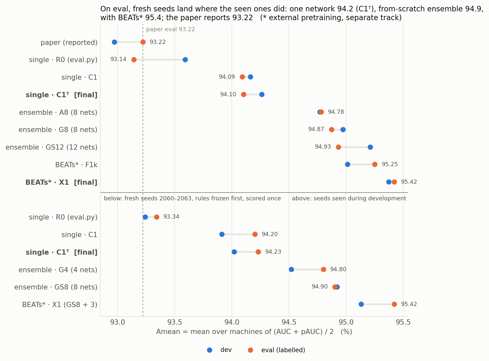
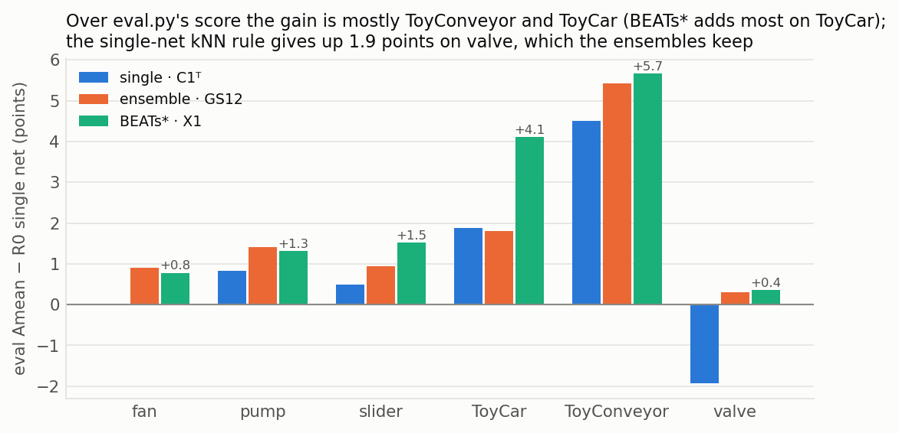
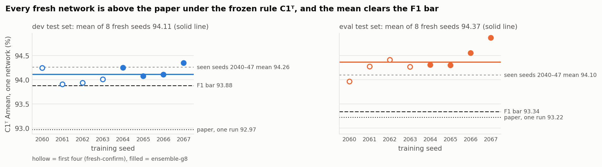

# synthesis/final — the best systems this repository has to offer

> **Status: FINAL, 2026-11-11.** Every number is read from committed scores. The fresh-seed
> confirmation (`../fresh-confirm`, seeds 2060–2063, rules and predictions frozen in d3472f2 before
> any fresh score) was scored once on 2026-11-11 and is included below.

## Answer

Amean = mean over the 6 machines of (AUC + pAUC) / 2, each pooled per machine as `eval.py`
does. The paper reports dev AUC / pAUC / mAUC 95.71 / 90.23 / 91.23 (Amean 92.97) and an eval
mean of 93.22. "Seen" seeds were used while the rules were developed; "fresh" seeds were trained
after every rule was frozen and scored once.

| track | final system | seen seeds, dev / eval Amean | fresh seeds, dev / eval Amean | fresh vs paper eval |
|---|---|---|---|---|
| single network | `ao_nogain` scored by **C1ᵀ** | 94.26 / 94.10 (mean of 8) | **94.02 / 94.23** (mean of 4) | +1.01 |
| ensemble, from scratch | Σ S1′ over 8 networks | A8 94.77 / 94.78; GS12 (12 nets) 95.21 / 94.93 | GS8 **94.92 / 94.90**; G4 (4 nets) 94.52 / 94.80 | +1.68 |
| **with external pretraining** | **X1** = from-scratch ensemble + 1.5·ΣzK′[BEATs ×3] | 95.37 / 95.42 | **95.13 / 95.42** (BEATs networks not fresh) | +2.20 |

- **One network beats every paper number on average, and it holds on unseen seeds.** Under C1ᵀ the
  four fresh `ao_nogain` networks average dev 96.48 / 91.57 / 93.09 and eval Amean 94.23. Each of
  the four is above each of the paper's four numbers. On the seen seeds 7 of 8 are above the
  paper's eval mean (s2040 scores 92.94).
- **The scoring rule carries that result, not the checkpoint alone.** Under `eval.py`'s own score
  (R0) the fresh mean is 93.24 dev / 93.34 eval. That is above the paper on average by 0.1 to 0.4,
  but only one fresh seed in four beats all four paper numbers. "Beats the paper" is claimed for
  C1ᵀ, not for R0.
- **From scratch, an ensemble reaches about 94.9 on eval, and the member mix is not resolvable.**
  - Seen seeds: A8, G8 and GS12 score 94.78, 94.87 and 94.93. GS12 was the dev pick and ties A8
    (CI [−0.02, +0.33]), so A8 stays the reported best by the rule written in advance.
  - Fresh seeds: GS8 is 94.90, only +0.09 [−0.08, +0.24] over four plain networks (G4, 94.80).
    At equal size, swapping two `ao_nogain` for two `sb_spec` networks is −0.09 on eval.
  - So `sb_spec` is not shown to help on eval. Dev favours the mix on both seed sets (+0.40; +0.26
    at equal size, 36 of 36 subsets), so the mix stays the dev-selected build.
  - An all-`ao_nogain` ensemble is the simpler alternative: one recipe, and no result here shows it
    to be worse on eval. That is an option, not a finding; an 8-network fresh `ao_nogain` ensemble
    was not trained.
- **With BEATs, the fresh X1 reaches 95.42 on eval**, +0.52 [+0.40, +0.67] over fresh GS8. The
  same 11-member build on seen seeds scored 95.32; the seen X1 (95.42) has 15 members. X1 uses
  external pretraining and never enters a from-scratch comparison. Its three BEATs networks and
  their weight are the phase-1 ones, chosen with this eval set already seen.

### Against published numbers

The literature computes AUC per machine ID and then averages; this repository pools the IDs of a
type (`PUBLISHED.md` has the checked table and the caveats). Per-ID figures exist for the fresh
systems only (`scores/summary.csv`, columns `*_Amean_perID`):

| system | dev Amean, per ID | eval Amean, per ID |
|---|---|---|
| fresh single network, C1ᵀ (mean of 4 seeds) | 94.16 | 94.29 |
| fresh GS8 (8 networks) | 95.07 | 94.69 |
| fresh X1 (GS8 + 3 BEATs) | 95.26 | 95.27 |
| OS-SCL paper, one run (convention not stated) | 92.97 | 93.22 |
| PerMix, TFSTgram-MFN, mean of 3 seeds (from scratch) | 93.44 | 93.97 |
| PerMix, BEATs fine-tuned, 3 seeds (external) | 94.49 | 95.58 |
| AdaBEAM, 5 trials (external) | 95.6 | 96.2 |

- The fresh single network is 0.7 dev / 0.3 eval above the only seeded from-scratch number we
  found (PerMix). The eval margin is about one standard error of our 4-seed mean, so on eval the
  two are level within noise. They also differ in network seeds, scoring rule and code, so this is
  not a controlled comparison.
- The external track is **not** state of the art: X1 is below AdaBEAM on both sets and below
  PerMix's fine-tuned BEATs on eval.

All rows, including the secondary pools, are in `scores/summary.csv`; per-machine rows are in
`scores/machines.csv`.

## Full table

| track | system | members | dev AUC | dev pAUC | dev mAUC | dev Amean | eval AUC | eval pAUC | eval mAUC | eval Amean | source |
|---|---|---|---|---|---|---|---|---|---|---|---|
| paper | OS-SCL (paper) | 1 | 95.71 | 90.23 | 91.23 | 92.97 | — | — | — | 93.22 | arXiv:2509.13853 |
| single | R0 = `eval.py` score, mean of 8 | 1 | 96.10 | 91.08 | 92.12 | 93.59 | 95.30 | 90.97 | 90.33 | 93.14 | `ablation/aug-ops` |
| single | C1, mean of 8 | 1 | 96.55 | 91.78 | 93.22 | 94.16 | 96.42 | 91.75 | 92.54 | 94.09 | `single-final` |
| single | **C1ᵀ**, mean of 8 | 1 | 96.61 | 91.91 | 93.35 | 94.26 | 96.45 | 91.76 | 92.61 | 94.10 | `single-final` |
| ensemble | **E2′[A8]** | 8 | 97.05 | 92.48 | 94.10 | 94.77 | 96.88 | 92.67 | 93.26 | 94.78 | `grand-ensemble` |
| ensemble | E2′[G8] | 8 | 97.19 | 92.76 | 94.12 | 94.97 | 96.96 | 92.77 | 93.35 | 94.87 | `grand-ensemble` |
| ensemble | E2′[GS12] (dev pick) | 12 | 97.38 | 93.03 | 94.71 | 95.21 | 97.00 | 92.86 | 93.31 | 94.93 | `grand-ensemble` |
| ensemble, secondary | E2′[NG18] | 18 | 97.38 | 93.04 | 94.67 | 95.21 | 97.02 | 93.10 | 93.35 | 95.06 | `grand-ensemble` |
| ensemble, secondary | E2′[FAST42] (dev rank 8 of 10 fixed pools) | 42 | 97.11 | 92.66 | 93.95 | 94.89 | 97.28 | 93.41 | 94.34 | 95.35 | `grand-ensemble` |
| ensemble, secondary | E2′[ALL50] (dev rank 10 of 10 fixed pools) | 50 | 97.02 | 92.48 | 93.67 | 94.75 | 97.25 | 93.30 | 94.35 | 95.28 | `grand-ensemble` |
| *external* | F1k = E2′[A8] + ΣzK′[B3] | 11 | 97.23 | 92.79 | 94.79 | 95.01 | 97.21 | 93.30 | 94.20 | 95.25 | `grand-ensemble` (`ablation/beats`) |
| *external* | **X1** = E2′[GS12] + 1.5·ΣzK′[B3] | 15 | 97.50 | 93.24 | 95.12 | 95.37 | 97.32 | 93.53 | 94.26 | 95.42 | `grand-ensemble` |
| fresh single | R0, mean of 4 | 1 | 95.83 | 90.66 | 91.46 | 93.24 | 95.34 | 91.34 | 89.53 | 93.34 | `fresh-confirm` |
| fresh single | C1, mean of 4 | 1 | 96.41 | 91.40 | 92.93 | 93.91 | 96.44 | 91.96 | 92.50 | 94.20 | `fresh-confirm` |
| fresh single | **C1ᵀ**, mean of 4 | 1 | 96.48 | 91.57 | 93.09 | 94.02 | 96.47 | 91.99 | 92.59 | 94.23 | `fresh-confirm` |
| fresh ensemble | G4 (4 `ao_nogain`) | 4 | 96.98 | 92.06 | 93.86 | 94.52 | 96.76 | 92.85 | 92.88 | 94.80 | `fresh-confirm` |
| fresh ensemble | GS8 (4 `ao_nogain` w2 + 4 `sb_spec` w1) | 8 | 97.25 | 92.60 | 94.39 | 94.92 | 96.90 | 92.90 | 93.15 | 94.90 | `fresh-confirm` |
| *external*, fresh from-scratch half | X1 = GS8 + 1.5·ΣzK′[B3] | 11 | 97.37 | 92.89 | 94.77 | 95.13 | 97.24 | 93.60 | 94.19 | 95.42 | `fresh-confirm` |

The paper's dev Amean (92.97) is the mean of its reported AUC and pAUC; the paper reports no eval
AUC, pAUC or mAUC separately. Rows above the fresh ones use networks whose eval scores were seen while
the rules were developed: seeds 2040–2047, plus s2050–51 and s2024–2031 members in the secondary
pools NG18, FAST42 and ALL50. The fresh rows use seeds 2060–2063.

## How each final system scores a clip

All systems use the EMA weights of networks trained with the fast recipe (`--amp fp16 --lean 1
--cache_dir data/cache`), 300 epochs, `--m 0.4 --fussion 1 --ht basic`.

- **R0** is `eval.py`'s score: the ArcFace cross-entropy of the clip against its own machine ID.
- **C1ᵀ** (single network; `../single-final/scores/final_rule.json`):
  - The score is zR0′ᵀ + zK′ᵀ + zGmean.
  - R0ᵀ is R0 averaged over circular shifts of 0, +1 % and −1 % of the clip.
  - K′ᵀ is the 1-NN cosine distance of the 128-d pre-head embedding to the ID's training clips,
    using the same shifts.
  - Gmean is the 1-NN cosine distance of the time-mean of `mobilefacenet.conv2` (512-d, unshifted).
  - Each term is z-scored per ID on the training clips the network trained on.
- **E2′[·]** (ensemble; `../grand-ensemble/score.py: ensemble_from_dumps`):
  - The score is the weighted sum of each member's S1′ = zR0′ + zK′, with no TTA and no Gmean.
  - In GS12 all 12 members have weight 1 (`../grand-ensemble/scores/dev_pick.json`). Only the
    size-matched fresh build (4 `ao_nogain` + 4 `sb_spec`) uses weights 2 : 1, which keeps GS12's
    8 : 4 type ratio.
- **X1** adds three BEATs members (`ablation/beats`, `bt_arc` s2040–2042) with weight 1.5 each.
  They contribute zK′ only, because their training CE sits at the fp32 floor.

## What this phase found

| study | question | answer |
|---|---|---|
| `single-final` | Does TTA add to C1 for one network? | Yes on dev (+0.10, 8/8 seeds). Flat on eval (+0.01, CI spans 0). **C1ᵀ adopted.** |
| `grand-ensemble` | Best ensemble from ~60 existing members, picked on dev only? | GS12: +0.44 dev, +0.16 eval vs A8. **Tie**, so A8 stays the reported best. Selection optimism +0.07. |
| `grand-ensemble` (external) | Does the GS12 swap carry over to the BEATs fusion? | X1 +0.17 [+0.02, +0.32] eval vs F1k. **Adopted** (thin). |
| `fresh-confirm` | Do the frozen rules hold on seeds nobody has scored (2060+)? | **C1ᵀ: yes** (4/4 seeds above every paper number). Ensemble level: yes (GS8 94.92 / 94.90). **`sb_spec` as an ingredient: yes on dev, not shown on eval** (eval +0.09, CI spans 0; −0.09 at equal size). BEATs fusion: yes (+0.52 eval). R0 against the paper: no (1 seed of 4). |

## Caveats

- **Valve, eval only.** Against R0, single-net C1ᵀ gains on 5 of 6 machines on eval but loses
  1.9 Amean points on valve (pAUC 91.70 vs 94.46) on the seen seeds. On dev, C1ᵀ is better on
  valve (99.42 vs 99.23), so this is an eval-only effect and cannot be acted on without selecting
  on eval.
  - Part of it is the kNN terms: C1 already lost to S1′ on eval valve (`pooled-knn`, −0.35 AUC).
  - TTA adds a little (pooled valve pAUC −0.37). `single-final` found every per-ID valve AUC flat
    or up, so this part is a calibration effect of per-ID z-scoring across IDs, not a detection loss.
  - The ensembles do not lose on valve (GS12 +0.31 vs R0).
  - It repeats on the fresh seeds: C1ᵀ is 1.8 Amean below R0 on eval valve (94.76 against 96.58,
    pooled) and 0.6 below per ID, and 0.3 above R0 on dev valve.
- **The diluted pools FAST42 and ALL50 have the highest from-scratch eval** (95.35, 95.28), but
  they rank 8th and 10th of the 10 fixed pools on dev (A8 counted, the greedy pick not). Picking
  them would be selecting on eval, so they are reported as secondary only.
- **Thin margins.** Among the dev-selected from-scratch ensembles (A8, G8, GS12, fresh G4 and GS8)
  every difference is under 0.5 Amean and none has a bootstrap CI above 0 on eval. The secondary
  pools do clear A8 on eval (NG18 +0.28, FAST42 +0.57, ALL50 +0.50, CIs above 0), but they were not
  picked on dev. The BEATs comparisons also clear 0 (X1 vs F1k, fresh X1 vs fresh GS8). The phase-1 noise floors still apply: ~1 point of eval AUC run to run,
  mAUC deltas under ~2 points unresolvable, ToyConveyor >4 points.
- **External pretraining** (BEATs, AudioSet) is a separate track throughout. In the fresh X1 only
  the from-scratch members are new; the three BEATs networks and their weight are the phase-1 ones.
- **The fresh `sb_spec` networks are weaker than the seen ones** (S1′ 93.36 dev / 92.74 eval against
  94.06 / 93.42, same recipe). `sb_spec` was chosen on the seen seeds, so part of its seen-seed
  level may have been seed luck; four seeds against four cannot separate that from bad luck now.
  Its ensemble gain on dev did not shrink (F4 +0.40 fresh against +0.34 seen).
- **Pooled against per-ID.** Our Amean pools IDs; on the fresh systems the per-ID figure is within
  0.25 of it, higher on dev and lower on eval for the ensembles.

## Fresh-seed confirmation

Eight networks on seeds nobody had scored: 4 × `ao_nogain` (`fc_nogain_s2060–2063`) and
4 × `sb_spec` (`fc_spec_s2060–2063`). Rules, bars and predictions F1–F6 were committed first
(d3472f2, addendum 32740ba). The scoring ran once, as two independent processes that agreed byte
for byte. Details and figures are in `../fresh-confirm/README.md`.

| id | claim | fresh result | verdict |
|---|---|---|---|
| F1 | one network under C1ᵀ replicates | 94.02 dev / 94.23 eval; bars 93.88 / 93.34 | passes |
| F2 | C1ᵀ beats the paper | dev AUC, pAUC, mAUC and eval mean each on 4/4 seeds | passes |
| F2 | R0 beats the paper | 2/4, 3/4, 2/4 on dev; 2/4 on eval | fails |
| F3 | C1ᵀ ≥ C1 | +0.12 dev (4/4 seeds), +0.03 eval | replicates on dev |
| F4 | adding `sb_spec` helps the ensemble | GS8 − G4: +0.40 dev, +0.09 eval [−0.08, +0.24] | passes, not confirmed |
| F4b | the same at equal size (4 nets against 4) | +0.26 dev (36/36 subsets), −0.09 eval (8/36) | helps on dev; member type not shown to matter on eval |
| F5 | GS8 level | 94.92 dev / 94.90 eval (predicted 95.1 / 94.85) | inside the intervals |
| F6 | BEATs fusion helps | X1 − GS8: +0.21 dev, +0.52 eval [+0.40, +0.67] | passes |

What did not replicate: the `sb_spec` contribution on eval, the level of the `sb_spec` single
networks, and R0 beating the paper's dev numbers seed by seed. `eval.py` reproduces the R0 column
of the fresh scores to 0.003 points on all 8 checkpoints.

## Reproduce

```bash
bash synthesis/final/run.sh            # collect.py -> scores/, make_plots.py -> plots/
```

`collect.py` reads only committed `scores/` from `ablation/aug-ops`, `synthesis/single-final`,
`synthesis/grand-ensemble` and `synthesis/fresh-confirm`. Re-scoring a system from
checkpoints is `../fresh-confirm/run.sh extract` + `score` (see that README).

## Figures

| figure | shows |
|---|---|
|  | Dev and eval Amean of each adopted system on seen seeds (top) and of the fresh builds (bottom). On eval the fresh single network (94.23), ensemble (94.90) and BEATs fusion (95.42) land within 0.15 of the seen ones. The fresh ensembles are smaller builds (8 and 11 members against 12 and 15). |
|  | Seen seeds 2040–2047: eval Amean gain over R0 per machine for C1ᵀ, GS12 and X1. Most of the gain is ToyConveyor and ToyCar. BEATs adds most on ToyCar. The single-net rule loses 1.9 points on valve. |
|  | The four fresh networks under C1ᵀ, seed by seed, with the F1 bar, the seen-seed mean and the paper. Every seed is above the paper on both sets. |
